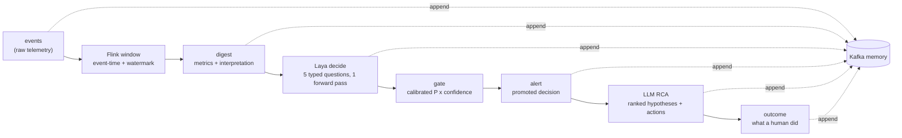

# brian 架构说明

本文档描述 `brian` —— 一个实时异常分诊（anomaly triage）系统。事实来源是仓库中的代码本身，主要是：

| 文件 | 承担的角色 |
|---|---|
| `src/brian/contracts.py` | 全部线上契约（Event / Digest / Decision / Alert / RcaReport / Lineage） |
| `src/brian/topics.py` | Kafka topic 目录与 key 的选择理由 |
| `src/brian/pipeline.py` | 编排，以及写入顺序的持久化论证 |
| `src/brian/state.py` | digest 渲染器、`Windower`、`BaselineTracker` |
| `src/brian/laya/qcatalog.py` | 5 个 typed question 的定义与证据映射 |
| `src/brian/laya/gate.py` | 动作门控（把概率翻译成“被允许做什么”） |
| `src/brian/calibration.py` | Platt 校准、AUC / ECE / Brier |
| `src/brian/llm/rca.py`, `src/brian/llm/prompts.py` | System 2 根因分析 |
| `src/brian/config.py` | 全部设置项（`GateThresholds`、`WindowSettings` 等） |

---

## 1. 一句话架构

**Flink 负责实时特征计算，Laya 负责快速异常判定（System 1），DeepSeek 等 LLM 负责根因分析与恢复方案（System 2），Kafka 作为全链路可追溯的 memory。**

把这句话拆成四条相互约束的规则：

1. **Flink 只做确定性计算。** 它把原始事件归约成一个窗口 digest：指标、基线、比值、robust z-score。同一批事件必须得到同一个 digest（`state.py` 的 `ServiceAggregator.reduce` 是纯函数），否则“重新判定历史窗口”这件事就不成立。
2. **Laya 只做判定，不做解释。** 它回答 5 个 typed question（`qcatalog.DEFAULT_QUESTIONS`），输出的是校准过的概率和标签，而不是一句话总结。它是一次前向传播，没有文本生成，因此可以在**每一个窗口**上运行。
3. **LLM 只做解释，不做判定。** 它把“`dependency_failure`, major, p=0.91”变成可执行的假设与恢复步骤，但它**从不参与告警是否发出的决策**。告警在 System 2 之前就已经写入 Kafka（`Pipeline.process_digest` 中 publish alert 在 `self.rca.analyse` 之前）。
4. **Kafka 是 memory，不是 log。** 每一个 hop 都被追加进 topic，并且每条记录都带 `lineage.upstream_ids`。这让“为什么系统在 10:08 重启了这个服务”可以用证据回答，而不是用叙述回答。

---

## 2. 数据流图



等价的 ASCII 版本（`src/brian/pipeline.py` 模块 docstring 中的那条链）：

```
events ─► windower ─► digest ─► Laya ─► gate ─► alert ─► System 2 ─► report
  │           │         │        │       │       │          │          │
  └───────────┴─────────┴────────┴───────┴───────┴──────────┴──────────┘
                    every hop is appended to Kafka (the memory)
```

### 责任的箭头方向

这条链上箭头的**方向**本身就是设计决定，值得单独说明：

| 环节 | 它回答的问题 | 它被允许做什么 |
|---|---|---|
| Flink | “这个窗口里发生了什么？” | 只计算，不判定 |
| Laya | “是否存在异常？” | 输出概率与标签；决定后续允许多少自动化（通过 `DecisionAction`） |
| gate | “这个概率和这个置信度，授权做什么？” | 只做策略映射，不重新判定 |
| LLM | “原因是什么？怎么办？” | 只推理与建议；`actions[].autonomous` 默认 `false` |

一句话：**Laya 判定是否存在异常，LLM 判定原因与方案。**

两条由这个方向导出的硬约束，都在代码里被显式实现：

- **LLM 从不为告警设门。** `ALERTING_ACTIONS`（`contracts.py`）只包含 `auto_triage` / `deep_analysis` / `page_human`，而它是由 `apply_gate` 在 System 1 的数据上算出来的。System 2 在告警之后运行；如果它挂了，`Pipeline.process_digest` 会把异常写进 DLQ 并**保留已经发布的告警**。
- **LLM 不制造事实。** `llm/prompts.py` 的 `SYSTEM_PROMPT` 明确要求“Never invent hostnames, commit ids, ticket numbers, person names, or metric values that are not in the input”，并且必须在 `missing_evidence` 里列出“要确定结论还需要什么”。

---

## 3. 为什么这样分层

分层的唯一理由是**延迟与成本的量级差异**。

| | Laya（System 1） | LLM（System 2） |
|---|---|---|
| 形态 | 单次前向传播，无文本生成 | 自回归生成 |
| 服务端延迟 | 稳态约 **35 ms**（本机测量） | 秒级，且随输出长度增长 |
| 本部署端到端 HTTP 往返 | **57–110 ms** 每次判定（90 窗口评测实测 p50 **75 ms**、p95 **81 ms**） | 不参与热路径 |
| 成本 | 自托管，单卡 GPU，按窗口计费≈0 | 按 token 计费，prompt 越长越贵 |
| 可运行频率 | **每个窗口都可以跑** | 只对少数被提升的告警跑 |
| 输入规模 | 5 个问题约 **1.2–1.6k input tokens** | prompt 含 digest 全文 + 指标块 + 最近 k 条原始事件 |

推论很直接：一个每次调用要秒级、要按 token 付费、还会产生幻觉的模型，**不可能**被放在“每 60 秒对每个服务判一次”的位置上。而一个 35 ms 的判定器可以。于是分工是：

- System 1 承担**广度**：所有服务、所有窗口、永不缺席。它便宜到可以对“安静的正常窗口”也做一次判定（这也正是 `SUPPRESS` 有价值的原因：每个被抑制的窗口都是一次没有把人叫醒的告警）。
- System 2 承担**深度**：只对已经被判定为异常、且已经生成告警的那些窗口做。它慢、贵、可能失败，这三件事都不影响告警是否送达。
- 人类承担**授权**：`DecisionAction.PAGE_HUMAN` 是唯一必须到达人的动作（`HUMAN_ACTIONS`）。

第一台机器上还有两个实测的延迟事实，都会影响部署预期：

- 服务刚启动后的**第一次推理约 0.65 s**，因为 CUDA 在第一次前向传播时编译/调优 kernel。
- 稳态下 `LayaClient` 的缓存是最大的延迟收益来源。Laya 是确定性的（不采样，同样的请求返回逐位相同的答案），所以**相同的 digest 可以从缓存回答**，而缓存不可能改变答案；`Decision.cache_hit` 记录了这个事实而不是让它被假设。

---

## 4. Kafka 作为 memory

### 七个 topic

主题常量冻结在 `src/brian/topics.py` 的 `Topic` 类里，producer/consumer 都 import 常量，所以一个拼写错误不可能悄悄创建出第二个并行 topic。名称带前缀（默认 `brian`，可用 `BRIAN_TOPIC_PREFIX` 覆盖）：

| topic | key | 内容 | 为什么用这个 key |
|---|---|---|---|
| `brian.events` | `service` | 原始遥测（metric / log / trace），system of record | 按服务有序；服务正是 Flink 做窗口的单元 |
| `brian.features` | `service` | Flink 窗口 digest：交给 Laya 的确定性特征快照 | 单服务的 digest 流保持有序，便于按时间回溯 |
| `brian.decisions` | `service` | 每个 digest 的 Laya 判定：verdict、questions、校准概率、gate action | 一个服务的判定历史有序 |
| `brian.alerts` | `service` | 被提升的异常，带 owner 路由 | 运维看到的 incident 流有序 |
| `brian.rca` | `alert_id` | 每个告警的 LLM 根因分析与恢复方案 | 同一个告警的全部推理被排到同一个分区，顺序完整 |
| `brian.outcomes` | `alert_id` | 实际做了什么、是否有效 | 反馈回路按 alert 读取；它也是**标签来源** |
| `brian.dlq` | `service` | 处理失败的记录及失败原因 | 便于按服务重放 |

`BRIAN_BUS_BACKEND` 决定 memory 落在哪里：`auto`（默认）在 kafka-python 可用**且** broker 有响应时用真集群，否则回落到本地 append-only JSONL journal（`var/journal/`）。journal 不是玩具：它保留了这个设计依赖的两条性质（append-only 顺序 + 按 offset 重放），所以 `brian demo` 走的是和集群完全相同的调用路径（`bus.append` / `bus.replay`），切换只是一行环境变量。

### 让它成为 memory 而不是 log 的两条性质

**性质一：append-only，永不修改。** 这个系统里没有任何代码 update 或 delete 一条记录。后来的矛盾是一条**新**记录，引用更早的那条。因此“系统在每一时刻相信什么”的历史被完整保留下来。

**性质二：完整 lineage（`lineage.upstream_ids`）。** 这是承重字段（`contracts.py` 的 `Lineage`）：

```
evt_*  events   ->  dgst_*  digests  ->  dec_*  decisions  ->  rca / rpl and outcome
(raw)              (features)            (Laya System 1)       (LLM System 2)
```

字段里还带着 `producer`、`model_id`、`prompt_version`、`code_version`。`producer="gate"` 的 decision 会记录 `model_id=typed-decisions`、`prompt_version=digest/1`；`producer="flink-digest"` 的 digest 记录 `code_version=digest/1`。所以一次判定到底是谁、用哪个模型版本、按哪版渲染文本做的，是可以从记录里直接读出来的，而不是靠记忆。

### 具体的审计查询

`Pipeline.lineage_of(record_id)` 就是这个查询的实现，CLI 入口是：

```bash
brian lineage alrt_5904362fb7ce
```

它的做法（见 `pipeline.py` 的 `lineage_of`）：先把 `events` / `features` / `decisions` / `alerts` / `rca` / `outcomes` 六个 topic 全量重放，按 `event_id` / `digest_id` / `decision_id` / `alert_id` / `rca_id` / `outcome_id` 建索引；然后从给定 id 出发，沿 `lineage.upstream_ids` 做广度优先回溯，最后反转顺序输出（最老的在前）。

在一次本地 journal 运行里，这条链的实例是：

```
[alerts]    alrt_5904362fb7ce   major / page_human / checkout-api: dependency failure (major)
[decisions] dec_1e5a53bf255d    verdict=anomaly action=page_human p=... category=dependency_failure
[features]  dgst_1bb67a3e364a   checkout-api window=... events=...
[events]    evt_... (该窗口的全部原始事件，受 Digest.lineage.upstream_ids 上限约束)
```

并且 `model_id` 一路写成 `typed-decisions`，`prompt_version` 写成 `digest/1`。也就是说：**从一个 outcome 往回走，可以走到当初支撑这个动作的原始事件，以及判定它们的模型版本。** 这正是 `contracts.py` 里那句话的含义——这是 Kafka 成为 memory 而不是 log 的原因。

---

## 5. Flink 的角色

### 事件时间窗口

生产路径由 Flink 拥有：并行度、checkpointing、exactly-once sink、背压。窗口语义是事件时间的，参数集中在 `WindowSettings`（`config.py`）：

| 设置 | 默认 | 含义 |
|---|---|---|
| `size_s` | 60 | 窗口长度 |
| `slide_s` | 60 | 滑动步长（默认等于 size，即 tumble） |
| `allowed_lateness_s` | 30 | 等迟到事件多久才关窗 |
| `idle_timeout_s` | 120 | watermark 空闲超时；没有它，一个安静的服务会卡住所有窗口 |
| `baseline_windows` | 30 | 滚动基线长度 |
| `min_events` | 10 | 事件不足这个数的窗口根本不被判定 |

关窗规则（本地孪生实现里写得很明确）：**按事件时间分配，当 `watermark > window_end + allowed_lateness` 时关闭，比这更旧的事件丢掉。** 迟到事件是**被计数**的（`Windower.stats["late_events"]`），不是被静默丢弃——一个丢了 40% 事件的窗口，它的判定本就应该被怀疑，而这只有在损失被记录下来时才可知。

### keyed state 与基线

基线是 per-(service, metric) 的滚动统计，是 Flink keyed state 的天然内容。`BaselineTracker` 在两边用的是同一个算法：保留最近 `baseline_windows` 个值，用 **median + MAD**（median absolute deviation）而不是 mean + std。理由写在 `state.py` 里：遥测是尖刺型的，30 个窗口的基线里有一次 60 秒的故障，就足以把标准差撑大到掩盖**下一次**故障；MAD 对单个野值不动。

还有一条容易搞反的顺序约束，在 `Pipeline.drain_ready` 里被显式固定：

```python
digest = build_digest(aggregator, self.baselines)
trace = self.process_digest(digest, events=...)
# Only now does this window become baseline material for *later* windows.
self.baselines.observe(digest.service, digest.metrics)
```

**被判定窗口不参与它自己作为对照的基线。** 反过来做，一个缓慢演进的故障会把自己 baseline 成正常——一个会适应它所应捕获的故障的检测器。

### 为什么 digest 是确定性的、并且带版本号

- 确定性来自纯函数：`ServiceAggregator.reduce` 的输出完全由“它收到的事件 + 传进来的基线”决定，所以一个窗口的 digest 可以从 `brian.events` 重新推导出来（`brian replay` 就是干这个的）。
- 版本号是 `digest_version`（当前 `digest/1`，定义在 `state.py` 的 `DIGEST_VERSION`）。渲染文本或指标 schema 变化时必须 bump。它写在每一个 digest 上，因此“上周二准确率为什么变了”可以通过 diff 两个渲染器来回答，而不是靠猜。

### 本地 `Windower` 孪生是干什么的

`state.Windower` 是 Flink job 在本地的一比一实现（Flink 侧是 `flink/job.py`）。它存在的理由只有一个：让上面那些东西**可寻址**。

- 一个进程、确定性顺序、不需要集群；
- 它让 digest 逻辑可以在没有集群的情况下被单测；
- 它让 `brian replay` 能从同一批原始事件重新推导出 Flink 产出的**完全相同**的窗口，从而回答“10:08 你为什么叫我？”；
- 它让整条链可以在 CI 里跑。

**两者必须一致**，否则 replay 一文不值。因此它们共享一切带语义的东西：窗口算法、digest 渲染器、问题目录、gate，以及 `Pipeline.process_digest`——Flink job 是 **import** 它，而不是重新实现一遍。唯一不同的是传输和超时。

---

## 6. Digest 文本是模型真正读的东西

这是整个系统里最不显然、也最容易做错的一点。

**Laya 是一个 encoder over text。它不计算，它阅读。** 所以一个窗口的命运是由**渲染出来的文本说了什么**决定的，而不是由喂进去的数字决定的。四个后果驱动了设计，其中第四条是整个系统里最大的一条实测杠杆：

**一、文本是版本化产物，不是字符串拼接。** 渲染器住在 `state.py`（`render_digest`），有 `DIGEST_VERSION`，可以被 review、被 diff、被单测。改一句话就是改模型行为，这必须是一次可见的提交，而不是某个 Flink operator 里顺手的一处编辑。

**二、机器真值与模型输入被分开。**

| 字段 | 谁读它 | 内容 |
|---|---|---|
| `Digest.metrics` | 审计者、离线评分、System 2 | 机器可读的真值：值、基线、`delta_ratio`、robust `z`、`error_signature`、`deploys` |
| `Digest.interpretation` | **Laya** | 渲染出的英文句子，也就是模型唯一真正条件化的东西 |

两者装在同一条记录里一起旅行。判定可以从记录本身复现（读 metrics），而模型的输入也被留档（读 interpretation）。

这里有一个实测得到的教训，写在 `LayaClient._state_payload` 的 docstring 里：**不要把 metrics dict 一起当 state 传。** Laya 的 `serialize_state` 对 dict 做 `json.dumps`，然后把结果丢进 document budget。于是模型读到的是 JSON 而不是散文——encoder 把预算花在标点上，而不是花在“什么动了”那句话上。因此 `_state_payload` 对 `Digest` 只返回 `state.interpretation` 这个纯字符串。数字并没有丢失——它们在已经写进 `brian.features` 的 `Digest` 记录里，也在 `Decision.answers` 里。

> 关于这条教训的两个历史 AUC 数字（曾被写作 0.782 与 0.876）：它们来自 `scripts/experiment_digest_phrasing.py`，那个 harness 自己造窗口、自己排基线序列，因此**它测的是自己的输入**，两个变体从未在可比输入上被打分。这个 harness 已被 `scripts/compare_renderers.py` 取代（复用生产 `Evaluator`，只替换 `(metrics) -> str`）。**结论方向（dict state 会退化状态文本）不受影响，但那一对具体数字不再被引用。**

**三、渲染是有预算的，而且超预算会被记录。**

`english` / `typed-decisions` 的序列被切成两段：问题 rubric 占用 head 段（`head_max_len = 192`），state 占用文档段，所以可用于 digest 的预算约为 `max_len - head_max_len`，即约 512 − 192 ≈ **320 tokens**（`multilingual` 是 1024 − 256 ≈ 768）。`state.py` 里的注释同时列出了这组数字，并注明上游 README 把 `typed-decisions` 记为 1024 上下文 / 256 head——本项目的保守下界是 512 − 192 ≈ 320 tokens。

据此定下 **`MAX_DIGEST_WORDS = 240`**（约 310 tokens，贴近英文 checkpoint 的天花板）。`render_digest` 的行序也是固定的、并且是有意义的：先服务本身，接着是“是否出了问题”的两个信号（错误、延迟），然后是解释**为什么**的资源项，再是最强的局部证据（dominant error template），最后才是会改变解读的上下文（deploy、负载形状、迟到）。原因很直接：**被截断的 encoder 保留头部**，所以最有决策价值的句子必须排在前面。

如果确实超预算，`render_digest` 返回 `(text, dropped_lines)`，`build_digest` 把丢弃的行写进 `metrics.render.dropped`。**它被记录，而不是被日志打印**——截断意味着模型是在部分证据上做的判定，这件事必须在该条记录里可见，而不是事后靠词数推断。

**四、渲染器是一个模型参数，而且是其中最主导的那个。** 同一批**逐字节相同**的 metrics，只换渲染方式，经**生产评测路径**（`python scripts/compare_renderers.py`：它复用生产的 `Evaluator`——同一个 windower、同一条 compare-then-observe 的基线顺序、同一个 `apply_gate`——只替换 `(metrics) -> str` 这一个函数）得到的 AUC：

| 渲染形式 | AUC | 说明 |
|---|---|---|
| dotted-key 账本（修复前的生产形态） | **0.002** | 查找全部落空，状态文本塌成一句话。同一形态另一次运行记为 **0.775**——一个不含信息的文本的排序会随样本任意摆动，`state.py` 把这段区间记作 “0.00-0.78 depending on the run” |
| 叙事 + 逐项复述数字（`prose_plus_deviations`） | 0.349 / 0.566 / 0.416 / 0.396，均值 **≈0.43** | 在叙事句子后面再逐项复述一遍数字（4 次重复测量） |
| 同一叙事 + z-score 与样本数 | **≈0.78** | 加了更精确的信息，结果反而更差 |
| **已发布形态**（只给 value 与 ratio，baseline 用同一单位） | **0.891**（seed 间 0.875–0.897） | 当前 `state.render_digest` |

**在状态文本里加更多精确信息，实测结果是更差，而不是更好**——0.891 在 seed 之间稳定，而“叙事 + 复述数字”的均值只有约 0.43。这正是 `render_digest` docstring 里那四条规则（只陈述比较本身、baseline 与 value 同单位、一行一个信号、没有 baseline 时明说）的来历：它们是**实测约束**，不是文风偏好。也因此，**改渲染器就是改模型**，必须走 `scripts/compare_renderers.py` 再跑 `brian eval`，并且 bump `DIGEST_VERSION`。

**这里曾经有一个 bug，而它生产出了一整套错误的结论。** 渲染器用**平铺**的 key 去查比较指标（`comparison.get("latency_ms.p99")`），而指标是**嵌套**存储的（`comparison["latency_ms"]["p99"]`）。每次查找都返回 `None`，于是每一行比较都变成沉默，模型读到的状态文本塌成一句不含任何指标的话。在那份文本上量出的 “AUC 0.775、概率带宽 0.0517、recall 0.000、所以只能靠微调” 全部是这个 bug 的产物：**模型当时读的是一份几乎空的文档。** 修好之后，同一批数据上的 AUC 是 **0.891**。教训是这一节的主题的一个特例——**一个查不到 key 的渲染器不会报错，它会安静地降低模型输入的质量，而下游每一个评测都会忠实地把这份质量差记录下来，当成模型的能力。** 所以 `render_digest` 现在用 `_dig(comparison, key)` 做路径行走，并在 `cmp_entry` 的 docstring 里写明了这次事故。

**语言约束：** digest 一律渲染为英文，rubric 也是英文，因为 `english` 与 `typed-decisions` 只读英文（上游 README 明确：英文 checkpoint 在非英文输入上会崩塌，同时保持自信——Khmer 是 0.000 accuracy @ 0.952 confidence）。中文或日文的运维界面属于**渲染层与 LLM 层**，不属于这里。非英文 digest 的路由目标是 `multilingual` checkpoint，代价是英文准确率下降（MASSIVE intent：英文输入上 0.783 vs 0.657）。`qcatalog.py` 因此与 checkpoint 无关，语言选择在 `LayaClient.model` 处显式做出。

---

## 7. Laya 判定层

### 五个 typed question

目录定义在 `src/brian/laya/qcatalog.py` 的 `DEFAULT_QUESTIONS`，版本号 `CATALOG_VERSION = "anomaly/1"`。

| 问题 id | 类型 | 作用 | 为什么是这个 primitive |
|---|---|---|---|
| `is_anomaly` | `noul` | 是否存在需要处理的异常 | `noul` 是 Laya 最强 primitive（上游 0.857）。**门控动作的那个问题必须是它**，不能是 `score` |
| `category` | `choice` | 属于哪一类（8 个 `IncidentCategory`） | `choice` 次强（0.733），8 个选项在 token 预算内 |
| `severity` | `score` | 影响多严重（4 级 ordinal） | `score` 最弱（0.723，上游明确点出 ordinal score 是短板），所以**只让它承担严重度**，不让它承承担存在性 |
| `blast_radius` | `choice` | 影响面（4 个选项） | 纯 `choice`，用于路由与页人的判断 |
| `needs_human` | `noul` | 是否应该立刻叫醒人 | 又是一个 `noul`，而且它的答案在门控里可以直接触发 `page_human` |

`is_anomaly` 排第一并且承担全部告警决策。如果它被写成 `{normal, minor, major, critical}` 上的一个 `choice`，“有没有问题”和“有多严重”就会被缠在一起：一个对严重度没把握的模型会报告“存在性没把握”。**拆开它们，才让 gate 能用高置信度对存在性动作，而在严重度不清楚时把问题升级给 System 2。**

### 证据映射是可校验的声明

`qcatalog.EVIDENCE` 为每个问题声明“它的证据来自 digest 的哪些字段”，例如：

```python
"is_anomaly": ("comparison.errors.ratio", "comparison.latency_ms.p99", "error_signature")
```

`validate_questions()` 会检查：每个声明的路径必须出现在 `RENDERABLE_METRICS` 这个渲染器**有能力**输出的白名单里。这条检查防止的失败模式是不可见的——**一个无法从 digest 回答的问题不会报错，它会给出一个建立在空无一物之上的自信答案。** 上游的说法很直接：Laya 是“a fast base to specialise, not a zero-shot decision engine”。

### 为什么 choice 的标签空间必须小（< 20）

选项共享固定的 head token 预算（`head_max_len`：`english` 192，multilingual/typed 256）。上游在 Banking77 上给出了代价：77 个选项只能分到 `(256-16)/77 ≈ 3–4` 个 token，准确率随之跌到 0.425（Jev 在 72 标签上是 0.870）。`QUESTION_LIMITS["choice_options_max"] = 20` 因此是一条**架构约束，不是风格建议**：8 个分类、每类约 20 tokens 很宽裕；40 个标签的 taxonomy 在纸面上放得下，在实践中会失败。

其余限额同样是被验证过的：`questions_max = 6`（问题越多，rubric 越会和 digest 争 `max_len`）、`score_levels_max = 6`、`rubric_words_max = 700`。另外 `validate_questions` 还会拒绝**没有描述的裸标签**，因为实测显示裸标签会掉准确率（同一张工单上 `manual_review` -> `reject`）。

---

## 8. 门控（gate）与两把尺子

`src/brian/laya/gate.py` 的 `apply_gate` 把“概率”翻译成“**被允许做什么**”。它是仓库里最保守的代码，理由只有一个：**Laya 出厂的概率还不足以为无人值守的自动化背书。** 上游服务自己就这么说（`limits.probability_calibration`）："the shipped temperatures are inherited from the base checkpoint (ECE 0.213); refit on your own held-out data before gating automation on confidence"。本项目自己的实测指向同一结论，而且更具体：**排序已经够用（AUC 0.891），概率不够用（ECE 0.293）**——所以 gate 保守的不是“要不要报警”，而是“允不允许无人值守地动手”（第 9 节）。

### 两把尺子，绝不用一把

| 尺子 | 字段 | 回答的问题 |
|---|---|---|
| 异常概率 | `Decision.anomaly_probability` | **是否存在**异常 |
| 模型置信度 | `Decision.confidence` | 模型**有多确定**自己知道这是什么 |

一个窗口可以是“自信的异常”（动手）、可以是“犹豫的异常”（交给 System 2 想想）、也可以是“自信的正常”（保持安静）——这是三种真实不同的状态，单一阈值会把它们压成一种。经典的生产事故是**只用 confidence 门控**：那样系统会在模型最自信地犯错时最激进地动手。

`_joint_confidence` 取的是 `category` 与 `severity` 两者中**较小**的置信度，而不是平均：category 很确定但 severity 是抛硬币时，系统事实上不知道这有多糟，取平均会把这一点藏起来。“判定的可靠度等于它最不可靠的那个组成部分。”

### 动作阶梯

| 动作 | 触发条件（`apply_gate` 中的 rule） | 含义 |
|---|---|---|
| `observe` | `anomaly_below_notify`：P 在 `anomaly_probability` 之上但低于 `notify_probability` | 真实但弱的信号：记录用于线下评估阈值，不打扰人 |
| `observe` | `uncertain_normal`：判为正常但置信度不够 | 记录，而不是宣布健康 |
| `suppress` | `confident_normal`：置信度 ≥ `suppress_confidence` **且** P ≤ `normal_probability` | 判定正常且足够确信，放着不管 |
| `auto_triage` | `confident_anomaly`：class/severity 置信度 ≥ `confidence_auto` | LLM 写叙述即可 |
| `deep_analysis` | `low_confidence_escalation` / `mid_confidence_escalation` | 模型说不出这是什么，于是**升级问题本身**，让 System 2 来推理 |
| `page_human` | `page_human`：severity ≥ `page_severity_rank`，或模型自信地要求人 | 立刻叫人 |

### 为什么“沉默”的门槛比“噪声”高

`suppress_confidence = 0.70`，而 `anomaly_probability = 0.5583`（扫出来的操作点；见第 9 节）。这是刻意的：**一次错误的沉默（真实故障无人听说）必须比一次错误的告警（有人划掉的页面）更难达到。** 系统被设计成**便宜到可以被忽略**，而不是**安静**。抑制是一个自信的声明，所以它被要求更高的证据标准。`threshold_ok()` 这个具名函数也承担一条安全性质：置信度缺失时**永远不满足**置信度要求。

全部数字集中在 `GateThresholds`（`config.py`）里，可以用环境变量覆盖。注意 `anomaly_probability` **不是 0.5**：0.5 是一个常规值，而这里的概率分布并不常规（原始概率落在约 0.34–0.47），所以这个默认值是 `scripts/threshold_sweep.py` 在 90 个带标签窗口上**扫出来的**操作点（见第 9 节）：

```python
anomaly_probability = 0.5583   # P(anomaly) 到此即视为异常（扫出来的操作点，不是 sigmoid 的中点）
notify_probability  = 0.5583   # 到达此值才值得记录为告警级异常
confidence_auto     = 0.75     # 无需 System 2 即可对 class/severity 动作
confidence_floor    = 0.45     # 低于此值判定不足以路由 -> deep_analysis
page_severity_rank  = 2        # major 及以上直接页人
trust_needs_human   = True     # 自信的 needs_human 也直接页人
suppress_confidence = 0.70     # 抑制需要的置信度（刻意高于 anomaly_probability）
normal_probability  = 0.35     # 高置信度下 P 低于此值才算“确信正常”
always_analyze_alerts = True   # 每个告警都让 System 2 解释
```

`GateOutcome.rule` 与 `gate_reason` 记录**是哪条规则触发的**。阈值改动是本系统行为变化最可能的单一原因，而“哪条规则生效”是从记录里归因这次变化的唯一办法。

---

## 9. 校准：排序可用，概率不可信

### 实测的故事

在生产渲染器（第 6 节的“已发布形态”）与扫出来的阈值 0.5583 下，`typed-decisions` 基础 checkpoint 在 90 个带标签的合成窗口（48 异常 / 42 健康，RTX 5070 Ti Laptop，Laya 本地服务在 8077 端口）上的端到端结果是：

| 测量 | 结果 |
|---|---|
| recall | **0.854**（95% CI 0.728–0.928），48 个事件中抓到 41 个 |
| false positive rate | **0.024**（95% CI 0.004–0.123），42 个健康窗口里 1 次误报 |
| precision | **0.976** |
| AUC | **0.891** |
| category accuracy | **0.604**（只统计被抓到的异常窗口） |
| severity MAE | **0.5** 级（0–3 scale） |
| calibration ECE | **0.293**（**不通过**） |
| 延迟 | p50 **75 ms**、p95 **81 ms**（完整 HTTP 往返，热态） |

两句话必须分开读：**排序是可用的**（AUC 0.891，阈值扫过之后 recall 0.854 对应 FPR 0.024），**概率不是**（ECE 0.293）。gate 的动作设计正是按这个区别来的——`apply_gate` 用校准后的 P 做存在性判断，而置信度只决定“被允许做什么”。

**概率压缩是真实的，值得单独记住。** 原始概率大致落在 **0.34–0.47**（约 0.13 宽的一条带），中心明显低于 0.5。这就是为什么阈值**必须被扫出来，而不是被假设**：一个 0.5 的常规阈值在这条带上并不对应“比不发生更可能”，而是对应一个任意的高分位。

**0.5 与扫出来的操作点**（`scripts/threshold_sweep.py`，90 个带标签窗口）：

| 阈值 | recall | FPR | precision |
|---|---|---|---|
| P≥0.5000 | 0.875 | 0.214 | 0.824 |
| P≥0.4300 | 0.5625 | 0.0952 | 0.871 |
| **P≥0.5583（出厂默认）** | **0.8542** | **0.0238** | **0.9762** |

第三个点是**仍能达到 0.85 recall 的最安静的点**，也是 `GateThresholds.anomaly_probability` 的默认值：相比常规的 0.5，它把 FPR 从 0.214 压到 0.0238，代价只是 recall 从 0.875 掉到 0.8542。选它的理由与告警疲劳有关——**一个没人读的检测器，不管离线表上的 recall 多好看，实际 recall 都是零**——而这次不必用 recall 去换安静。这组阈值是**测量值，不是约定值**：它们属于你的流量，重新测一遍就整张表都会移动。

**`brian eval` 仍然打印 `NOT_READY`，而这是正确的。** `eval.gate_recommendation` 的门槛是 recall ≥ 0.85、FPR ≤ 0.05、ECE ≤ 0.10（合取）：前两项过了（0.854 / 0.024），ECE 0.293 没过。**按 System 1 的 `AUTO_TRIAGE` 判决直接动手，意味着信任一个错了约 0.29 的概率**，所以 gate 继续把判定升级给 System 2。这不是故障，而是 `confidence_floor = 0.45` 存在的理由。

### 校准是修概率的那一级

修 ECE 的地方是 `brian calibrate`，它的工具是 **Platt（slope + intercept）**：

```
p' = sigmoid(slope * logit(p) + intercept)
```

**为什么必须是两个参数，而不是一个温度。** 温度是 logit 上的纯缩放：它只能把分布拉宽或收窄，**不能移动分布的中心**。而这里的失效模式恰恰是位置问题——整条概率带都低于 0.5——所以单参数温度没法把决策边界搬到信号所在的地方，slope + intercept 可以。`fit_calibration`（`calibration.py`）用 Newton-Raphson 在 (slope, intercept) 上做最大似然。

**关于“已经修好了”的诚实说明。** 仓库里存在的是**拟合机制与它的护栏**，不是一次被验证过的生产校准（`models/calibration/` 目录当前不存在，也就是说没有拟合文件被采用；没有文件时这一步是空操作，系统跑的是原始概率）。护栏有两条，都是可核查的：

- `CalibrationFit.discriminates` 以 **AUC ≥ 0.6** 为界。`fit_calibration` 在 AUC 低于此值时**拒绝写出**拟合文件，并把之前写过的那个删掉（“it was masking this problem”），除非显式 `--force`；一个无法区分两类别的 checkpoint 加上一个让 ECE 看起来更好的校准，会得到“看起来修好了”而 recall 仍然是零的效果——这比诚实的“每个窗口 0.45”更糟。
- 它**同时报出 AUC 与 ECE**，这不是装饰：**AUC 在任何单调重标定下都不变**，所以它是唯一能回答“这里的信号是真的，还是校准造出来的假象”的指标。AUC 0.891 远在 0.6 之上，所以这台机器现在会接受一次拟合——但**校准不会把 ECE 0.293 变成 0**，它只是把概率搬到更接近频率的位置，结果必须重新评测（`brian eval`）。

**`brian calibrate --from-outcomes` 是在真实标签上拟合的路径**，也是标签一旦存在之后的**首选标签来源**：合成窗口的 ECE 与真实流量的 ECE 不是同一个量，而 `brian.outcomes` 是唯一带真实标签的集合（它目前还没有生产者，见 `docs/KAFKA_TOPICS.md` 第 4.8 节）。

### 阈值是策略，校准是测量

`apply_gate` 的顺序是：**先校准 P(anomaly)，再让任何阈值看到它。**

```python
anomaly_probability, calibration_record = calibrate_anomaly_probability(raw_probability, calibrator)
```

这个顺序就是防止阈值变成围绕一个失准模型调出来的魔法数字的办法。阈值调优应该建立在“概率已经说人话”的前提上，这样 `0.5` 才能重新意味着“比不发生更可能”——而**在概率还没校准的时候，阈值只能从代价曲线里挑，不能从惯例里拿**（第 9 节那张表就是这么来的）。

运行 `brian calibrate` 时，它还会把**操作点**存进 fit 文件（`--max-fpr` 默认 0.10，`--alert-rate` 默认 0.01），也就是说阈值不是留在某人的记忆里，而是和拟合结果放在一起。代价曲线本身由 `scripts/threshold_sweep.py` 产出，第 9 节那张表是它在 90 个窗口上的结果。

**操作点当前在配置里，不在拟合文件里**：`GateThresholds.anomaly_probability = 0.5583` 是扫出来的（`P≥0.5583 → recall 0.8542 / FPR 0.0238 / precision 0.9762`），而 `models/calibration/` 目录当前不存在。两者只有在 `brian calibrate` 接受一次拟合之后才会汇合；在那之前，配置里的阈值就是权威。

---

## 10. LLM 根因分析层

由 `src/brian/llm/rca.py` 的 `RcaEngine` 与 `src/brian/llm/prompts.py` 承担，输出 `RcaReport`（`contracts.py`）。它只对**被提升的告警**运行（`GateThresholds.always_analyze_alerts = True`），因为它是系统里“被允许变慢”的那一半。

### 必须有备选假设

`rca_json_schema()` 要求 `hypotheses` 至少 1 个、最多 4 个，每个必须携带 `cause`、`confidence`、`evidence_for`、**`evidence_against`**。`RcaEngine._from_llm` 会对“没有 hypotheses”或“缺少必需 key”直接抛 `LlmResponseError`，注释写着：“a single unqualified cause is not acceptable”。

理由是可审计性：**一个被断言而没有任何备选的根因，正是这整套设计要避免的失败模式。** 读到 `hypotheses[1]` 的运维可以在两秒内看出它依赖的是一个只动了 1.2x 的指标并把它丢掉；一个单一的自信结论没有办法这样被审计。

### prompt 里明说“你没有得到什么”

`EVIDENCE_GAPS` 常量把系统的真实盲点写进 prompt：

- 日志内容被归一化为每个窗口一个模板加计数，除了最高频的那一条之外没有原始日志行；
- 没有 deploy history、commit log、变更单；
- 没有服务依赖图或 tracing 数据；
- 只有当前窗口和它的基线，没有其他服务、其他窗口；
- 基线是 median absolute deviation 的滚动 robust median，不考虑已知的未来事件（计划中的大促、维护）。

一个不知道自己缺什么的模型，会从听起来熟悉的症状里编出一个合理的病因。所以 prompt 列出不可得的证据，并要求把“要确定结论还需要什么”填进 `missing_evidence`——它同时就是运维的下一步排查清单。系统提示词还明确禁止编造主机名、commit id、工单号、人名或输入里没有的指标值，并禁止把“重启服务”当作诊断。

### 离线确定性推理器是一等公民，不是错误路径

`OfflineReasoner` 是同一窗口上的确定性规则推理，7 条规则，每条都编码的是一个**判别器**而不是相关性：

| 判别 | 规则 |
|---|---|
| `dependency_failure` vs `resource_exhaustion` | 本地连接池饱和 + upstream 错误/超时上升 -> dependency；CPU/线程饱和且错误集中在本地 -> resource |
| `traffic_surge` vs 真故障 | 吞吐上升 **且** 错误率平 -> surge（健康）；吞吐上升 **且** 错误率也上升 -> 是故障不是 surge |
| `config_or_deploy` | 窗口内有 deploy/flag 记录且症状与它同时开始 -> 相关性（并显式列出缺失的变更历史） |

规则用 `min_ratio = 1.8` **和** `min_z = 3.0` 双重判定“这个指标动了”，因为一个在非常稳定的指标上的尖刺（z 很大、ratio 很小）不应该被报告成事故。

三条性质让这个离线路径值得信任：

1. 没有 LLM 时它**不返回空、也不幻觉**，而是给出同一形状的结论，并把报告标记 `degraded: true`；
2. 它的 `OfflineReasoner._actions` 里**每一个 action 都是 `autonomous: False`**，注释写着 “A rule engine cannot judge blast radius, and the only honest position for it is to propose”；
3. 一条规则都不命中时，它会明确说“证据不足以命名原因”，并列出下一步需要看什么——因为编一个原因正是这套设计要防的事。

`RcaEngine.analyse` 的失败语义也被刻意设计过：**LLM 掉线绝不会丢失告警。** 它要么降级为规则报告，要么把失败计入 `fallback_reports` 并留下 warning，但绝不向调用方抛异常（`pipeline.py` 里那层 `except Exception` 是最后的防线）。运维上的区别是：LLM 挂一个小时是事件记录里的一个脚注，而不是一段空白。

---

## 11. 可观测性与诚实边界

系统的每个 hop 都以 JSON 记录落在 memory 里，`Pipeline.summary()` 汇总 `Counters`（`events_in`、`late_events`、`windows_skipped`、`anomalies`、`suppressed`、`observed`、`alerts`、`pages`、`rca_degraded`、`dlq`、`laya_cache_hit_rate`、`mean_laya_latency_ms`）。`brian tail` / `brian lineage` / `brian replay` 读它。

**已知限制（KNOWN LIMITATIONS），全部带实测数字：**

1. **基础 checkpoint 作为排序器可用，作为概率源不可用。** 在生产渲染器与阈值 0.5583 下：AUC **0.891**、recall **0.854**、FPR **0.024**、precision **0.976**；但 ECE 是 **0.293**。**不要把“概率不可信”读成“没有信号”**——这曾经是本文档的错误结论，而它是渲染器 bug 的产物（第 6 节）。
2. **概率被压缩成一条窄带。** 原始概率大致落在 **0.34–0.47**（约 0.13 宽），中心低于 0.5，所以阈值只能从代价曲线里扫出来（0.5583），不能从惯例里拿 0.5。
3. **三个验收门过了两个，ECE 没过。** `eval.gate_recommendation` 的门槛是 **recall ≥ 0.85、FPR ≤ 0.05、ECE ≤ 0.10**（合取）：0.854 与 0.024 在门槛内，**0.293 远在门槛外**，所以当前结果正确地是 `NOT_READY`，gate 继续升级给 System 2。
4. **渲染器是最大的单一杠杆。** 在逐字节相同的 metrics 上，不同渲染方式的 AUC 分别是 **0.002**（修复前的 dotted-key 形态；同一形态另一次运行记为 0.775）、**≈0.43**（叙事 + 复述数字）、**≈0.78**（叙事 + z-score 与样本数）、**0.891**（已发布形态）。加更多精确信息实测更差。因此渲染器改动**必须**按模型改动对待，重新测量。
5. **类别质量弱。** category accuracy **0.604**（只统计被抓到的异常窗口），severity MAE **0.5** 级；`demo.py` 里刻意设置的 confuser 仍然会被混淆（`traffic_surge` 与 `resource_exhaustion` 的吞吐/延迟形状相似）。弱，但不是随机：随机猜 8 个类别是 0.125。
6. **`traffic_surge` 被系统性地漏掉（6/6 一个没抓）——而这是一个标签问题，不是模型 bug。** `traffic_surge` 窗口的 `mean P(anomaly)` 是 **0.367**，比**所有**健康场景都低（`normal` 是 0.398）：模型把“负载上升 12 倍、错误率持平”读成了正常的负载，而合成真值把它标成异常。逐场景异常准确率：`normal` 0.976、`dependency_failure` 1.000、`resource_exhaustion` 1.000、`data_quality` 1.000、`security` 1.000、`config_or_deploy` 0.833、`traffic_surge` **0.000**。**这是一个必须在真实部署里被刻意做出的标注决定**（见本节末尾的开放问题）。
7. **样本很小。** 90 个窗口、48 正例。`eval.py` 为 recall/FPR 输出 Wilson 95% 区间（0.854 的区间是 0.728–0.928，0.024 的区间是 0.004–0.123——**FPR 的下界接近 0，上界 12%，这个区间比点估计更接近事实**），并在样本 < 30 时直接判 `not_ready`。`0.9 recall on 10 positive windows is not evidence`。
8. **延迟是部署相关的。** 57–110 ms 是本机全 HTTP 往返（90 窗口评测里 p50 75 ms、p95 81 ms），稳态服务端约 35 ms；服务启动后第一次推理约 0.65 s。
9. **digest 是有损的。** 日志被归一化到每窗口一个 dominant template；`MAX_DIGEST_WORDS = 240` 之上会被丢弃并记录进 `metrics.render.dropped`。被截断就意味着模型是在部分证据上做的判定。
10. **词预算存在两套数字。** `state.py` 按 512−192≈320 tokens 规划（保守下界），而上游 README 把 `typed-decisions` 记为 1024/256。文档与代码都以保守下界为准。

### 开放问题：合成真值与模型解读在 `traffic_surge` 上直接冲突

第 6 条不只是“一个类别的准确率低”。`demo.EXPECTED` 把“吞吐涨 12x、错误率与 p50 延迟都平”的窗口标成 `traffic_surge / minor` 异常，而模型一致地回答“这是正常负载”——并且它对这批窗口给的 P(anomaly)（0.367）比任何健康场景（0.398）都低。两边的立场都能辩护：

- **真值一侧**：容量规划需要知道负载翻了一个数量级；一个流量激增即使没有报错，也是应该有人看一眼的事件。
- **模型一侧**：错误率与延迟都没动，`OfflineReasoner` 的判断规则也是这么写的（`traffic_surge vs 真故障`：吞吐上升 **且** 错误率平 -> surge（健康））——也就是说**同一套代码在两条路径上给了相反的标签**。

这不是可以用阈值或校准解决的分歧，也不是微调能解决的分歧（微调会学真值，但那只是把标注决定烧进权重）。**真实部署必须刻意决定它要哪一种**：要么把 `traffic_surge` 从异常集合里移出去、当成容量信号另走一条通道，要么保留它作为异常，并接受必须提供区分“良性负载上升”与“负载压垮了什么东西”的证据（例如容量余量、队列深度、饱和度趋势）——而当前 digest 里没有这些字段（见第 6 节的渲染器规则：加字段意味着减字段，词预算上限是 `MAX_DIGEST_WORDS = 240`）。

**当前的门是“升级而不是动作”，而拦住它的只有 ECE。** `gate_recommendation` 的 `guidance` 说得很直接：`not_ready` 意味着 gate 应该继续把判定升级给 System 2，而不是单独按 System 1 行动——这是**出厂配置，不是故障，而正是 `confidence_floor = 0.45` 存在的理由**。recall 与 FPR 已经进门槛了；卡住的是“这个概率说 0.7 的时候并不是 70%”，而 gate 恰恰是按概率动作的。

---

## 12. 部署形态

### 两种 memory 后端，同一套代码

| 形态 | 后端 | 用途 |
|---|---|---|
| 本地 journal 模式 | `JournalBus`，每个 topic 一个 append-only JSONL 文件（`var/journal/`） | `brian demo`、`brian eval`、CI、单机审计。不需要任何基础设施 |
| Kafka + Flink 模式 | `KafkaBus`（kafka-python），`flink/job.py` | 生产：并行度、checkpointing、exactly-once sink、背压 |

选择由 `BRIAN_BUS_BACKEND` 决定（`auto` / `kafka` / `journal` / `memory`）。`auto` 会先试真集群，失败则回落 journal。上面没有任何一层代码需要分支。`KafkaSettings.acks = "all"` 是刻意的：Kafka 是 memory，所以默认等所有 in-sync replica 确认，而不是 fire-and-forget。`brian topics --partitions 3` 用 `topics.describe()` 的 plan 建 topic。

### Laya 的服务边界：为什么是 HTTP，不是 import

`LayaSettings.url`（默认 `http://127.0.0.1:8077`）说明 Laya 是**通过 HTTP 访问**的，`laya/client.py` 的模块 docstring 给了三条理由：

1. **这个进程里没有 torch。** Flink task manager 是一个小的 CPU 容器，GPU 机器服务所有流。在这里 import Laya 会把 421M 参数和一个 CUDA context 塞进一个 stream operator 里。
2. **只有一个地方需要调优。** 预加载、`max_loaded`、设备选择、checkpoint 常驻是**服务**的事（`LAYA_PRELOAD`、`/health.warmed`），不是 pipeline 的事。
3. **边界是可观测的。** 每次调用的延迟、routing reason、token 用量都记录在 decision 上，这正是“它当时为什么这么判？”后来能被回答的原因。

客户端还有几处刻意的收缩：`verify_model()` 在启动时对 `/v1/capabilities` 校验配置的 checkpoint 是否存在（“模型名写错”和“模型没下载”在一串糟糕判定后面看起来完全一样，这一步让它们在启动时就可区分）；重试只覆盖传输失败，4xx 是请求本身的 bug，重试一个畸形请求只会给系统性故障加延迟；`LayaUnavailable` 与 `LayaResponseError` 被分开，因为前者意味着**推迟**（digest 已在 Kafka 里，可以之后再判），后者意味着集成坏了、记录该进 DLQ 让人看见。

`brian config --laya` 会打印 Laya 的健康、设备、已加载 checkpoint 与配置模型，作为上线前的一次快速核对。

---

## 尚未验证的部分

以下内容**没有**被验证过，文档不主张它们可用：

1. **Kafka 与 Flink 路径没有对真实集群跑过。** 本仓库中所有测试、demo、eval 都跑在 `JournalBus` / `MemoryBus` 上。`KafkaBus` 的分区、offset 提交、exactly-once sink、`flink/job.py` 的 watermark 与 keyed state 行为，都只是设计与共享代码（`Pipeline.process_digest`、`Windower`、`render_digest`）层面的一致性，不是集群上的实测。`idle_timeout_s = 120` 对一条真实多服务流的实际影响也没有被测量。
2. **Laya 的微调还没有跑过，也没有任何校准拟合被采纳。** 本仓库中所有数字都来自**基础** checkpoint（`typed-decisions`，未针对本领域微调）。上游测得的“base checkpoints 在 typed-decisions 上 0.362/0.342，低于多数类 0.461”是上游在其自有 benchmark 上的结论；本项目在本领域合成窗口上测到的是**另一幅图景**：基础 checkpoint 作为排序器可用（AUC 0.891、recall 0.854 @ FPR 0.024），概率未校准（ECE 0.293），类别准确率偏弱（0.604）。`models/calibration/` 目录当前不存在，也就是说 `brian calibrate` 的拟合机制存在、护栏存在（AUC ≥ 0.6 才写文件），但**没有一次生产校准被验证过**。微调仍然推荐——它是把 ECE 与类别准确率做上去的路径——但它是**改进**，不是对“没有判别能力”的抢救。微调后的 checkpoint 能把 ECE 压到 0.10 以内、把类别准确率抬到多少，**未知**。
3. **全部数字都来自合成遥测。** 窗口由 `src/brian/demo.py` 生成（7 个场景，seed `20260114`），标签由 `demo.EXPECTED` 给出。它们被刻意设计成互相混淆（`normal` 与 `traffic_surge` 都显示吞吐大幅上升；`resource_exhaustion` 与 `dependency_failure` 都显示延迟与错误上升），但**它们仍然是合成数据**：真实流量的尖刺形状、基数、噪声结构、标签本身的模糊程度都不同。真实 `brian.outcomes` 标注样本量为零，因此真实数据上的 recall / FPR / ECE 一个都没有测过。而且至少有一处**合成真值与模型解读直接冲突**（`traffic_surge`，见第 11 节的开放问题），这本身就说明合成标签不是中立的裁判。
4. **未经真实事件检验的阈值。** `GateThresholds` 的全部默认值（包括 `anomaly_probability = 0.5583` 这个扫出来的操作点）以及 `MAX_DIGEST_WORDS = 240`，都是在 90 个合成窗口上选出的**临时**取值；它们需要在你自己的流量上、以及在微调之后重新标定一遍——整张代价表都会移动。
